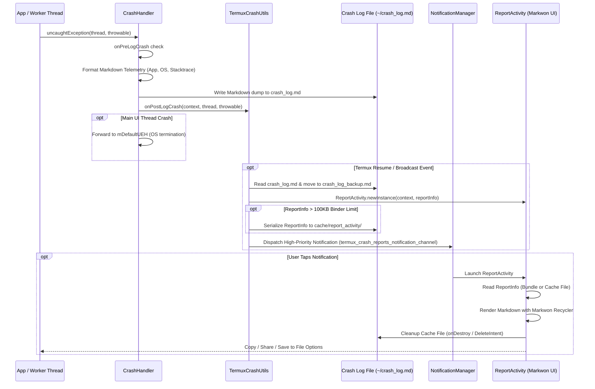

# Crash Handling & Diagnostics

The crash handling and diagnostics subsystem (`com.termux.shared.crash`, `com.termux.shared.termux.crash`, and `com.termux.shared.activities`) provides process-wide uncaught exception interception, telemetry aggregation, persistent file logging, system notification alerts, and Markwon-rendered crash reporting interfaces across Termux and its plugin applications.

---

## Architecture & Diagnostic Flow

*Process-wide exception interception, telemetry persistence, notification dispatch, and diagnostic display pipeline.*

---

## Core Subsystem Components

### 1. `CrashHandler` (`com.termux.shared.crash.CrashHandler`)
`CrashHandler` implements `java.lang.Thread.UncaughtExceptionHandler` to trap uncaught exceptions across all application threads.

- **Registration Modes**:
  - `setDefaultCrashHandler(context, client)`: Installs `CrashHandler` as the default process-wide handler during `TermuxApplication.onCreate()`, wrapping the existing `Thread.getDefaultUncaughtExceptionHandler()` into `mDefaultUEH` with `mIsDefaultHandler = true`.
  - `setCrashHandler(context, client)` & `getCrashHandler(context, client)`: Configures a `CrashHandler` instance specifically for non-main background threads with `mIsDefaultHandler = false`.
- **Interception & Lifecycle Hooks**:
  - When `uncaughtException(thread, throwable)` is invoked, `CrashHandler` first triggers `mCrashHandlerClient.onPreLogCrash(context, thread, throwable)`. If `onPreLogCrash` returns `true`, further log writing is bypassed.
  - If not bypassed, `logCrashToFile(...)` formats an extensive Markdown crash report combining:
    - **Crash Metadata**: Thread string representation and UTC millisecond timestamp (`AndroidUtils.getCurrentMilliSecondUTCTimeStamp()`).
    - **Exception Details**: Exception message and formatted stacktrace frames (`Logger.getStackTracesMarkdownString`).
    - **App Metadata**: App version name, version code, target SDK, and build variant supplied by `CrashHandlerClient.getAppInfoMarkdownString(context)`.
    - **Device Telemetry**: Manufacturer, model, OS version, API level, CPU ABIs, bootloader, and kernel info (`AndroidUtils.getDeviceInfoMarkdownString(context)`).
  - The Markdown telemetry dump is logged to logcat via `Logger.logError(...)` and persisted to disk via `FileUtils.writeTextToFile(...)` at the path provided by `mCrashHandlerClient.getCrashLogFilePath(context)`.
  - After logging, `mCrashHandlerClient.onPostLogCrash(context, thread, throwable)` is called.
- **Thread Isolation & Delegation**:
  - For the default handler (`mIsDefaultHandler == true`), after logging completes, the exception is delegated upstream to `mDefaultUEH.uncaughtException(thread, throwable)` so default Android OS crash semantics and process termination take place.
  - For non-main background threads (`mIsDefaultHandler == false`), `mDefaultUEH` is not called, trapping background exceptions without forcibly terminating the main UI process unless configured otherwise.

### 2. `TermuxCrashUtils` (`com.termux.shared.termux.crash.TermuxCrashUtils`)
`TermuxCrashUtils` implements `CrashHandler.CrashHandlerClient` and bridges raw crash events with Termux storage, preferences, and notification channels.

- **Crash Log File Location**: Directs `CrashHandler` to log crash dumps at `TermuxConstants.TERMUX_CRASH_LOG_FILE_PATH` (`/data/data/com.termux/files/home/crash_log.md`).
- **Post-Log Broadcast Dispatch**: In `onPostLogCrash(...)`, if the crash occurred in a plugin or caught execution block, `TermuxCrashUtils` sends an `ACTION_NOTIFY_APP_CRASH` broadcast to `com.termux` so the primary UI can inspect the log file. For uncaught main app crashes (`TYPE.UNCAUGHT_EXCEPTION`), broadcast dispatch is omitted because the app process is terminating.
- **Log Processing & Backup**:
  - `notifyAppCrashFromCrashLogFile(context, logTag)` is triggered when `TermuxActivity` resumes (`onResume`) or receives `ACTION_NOTIFY_APP_CRASH`.
  - Verifies user preference `areCrashReportNotificationsEnabled(false)`. If enabled, it spawns a background thread to read `crash_log.md`.
  - Upon reading the report, `crash_log.md` is moved to `TermuxConstants.TERMUX_CRASH_LOG_BACKUP_FILE_PATH` (`crash_log_backup.md`) to prevent duplicate notification triggers.
- **Notification Alerting**:
  - `sendCrashReportNotification(...)` constructs a `ReportInfo` model populated with report details, app metadata, device telemetry, and a report issue suffix (`TermuxUtils.getReportIssueMarkdownString`).
  - Configures high-priority system notification channel `termux_crash_reports_notification_channel` (`NotificationManager.IMPORTANCE_HIGH`, `Notification.PRIORITY_HIGH`).
  - Applies Markdown styling to notification text using `MarkdownUtils.getSpannedMarkdownText`.
  - Generates a unique notification ID via `TermuxNotificationUtils.getNextNotificationId(context)` and posts the alert with a `PendingIntent` launching `ReportActivity`.

### 3. `ReportActivity` (`com.termux.shared.activities.ReportActivity`)
`ReportActivity` is an `AppCompatActivity` designed to parse and render Markdown diagnostic reports according to the CommonMark specification.

- **Activity Manifest Setup**:
  - Registered with `documentLaunchMode="intoExisting"` and flags `FLAG_ACTIVITY_SINGLE_TOP`, `FLAG_ACTIVITY_NEW_TASK`, and `FLAG_ACTIVITY_NEW_DOCUMENT` to present reports as separate documents in Android Recents.
- **Binder IPC Safety & Disk Caching**:
  - Android Intent bundles impose a strict binder transaction limit (`TRANSACTION_SIZE_LIMIT_IN_BYTES`, ~100KB).
  - In `ReportActivity.newInstance(context, reportInfo)`, if the serialized size of `ReportInfo` exceeds this limit, the object is written to disk under `context.getCacheDir()/report_activity/report_info_<timestamp>`.
  - `newInstance` returns a `NewInstanceResult` containing `contentIntent` with extra `EXTRA_REPORT_INFO_OBJECT_FILE_PATH` and a `deleteIntent` targeting `ReportActivityBroadcastReceiver`.
  - On launch (`updateUI`), `ReportActivity` reads and deserializes `ReportInfo` from the cache file path if present.
- **Cache Purging & Lifecycle Cleanup**:
  - Temporary `ReportInfo` cache files are deleted in `onDestroy()`, on intent updates (`onNewIntent()`), or when `ReportActivityBroadcastReceiver` receives `ACTION_DELETE_REPORT_INFO_OBJECT_FILE` upon notification dismissal.
  - `deleteReportInfoFilesOlderThanXDays(context, days, isSynchronous)` cleans up orphaned cache files older than a specified number of days during app startup or background maintenance.
- **Markwon Markdown UI Rendering**:
  - Markdown rendering uses the Markwon library (`io.noties.markwon:core`, `io.noties.markwon:recycler`, `io.noties.markwon:linkify`).
  - Rendered inside a `RecyclerView` using `MarkwonAdapter.builderTextViewIsRoot(R.layout.markdown_adapter_node_default)` with custom code block views (`R.layout.markdown_adapter_node_code_block`, `FencedCodeBlock`).
  - Memory safeguard: Reports exceeding `ACTIVITY_TEXT_SIZE_LIMIT_IN_BYTES` (1MB) are truncated using `DataUtils.getTruncatedCommandOutput(...)` to prevent `OutOfMemoryError`.
- **User Actions & Sharing Options**:
  - Options menu items provide:
    - **Copy to Clipboard**: `ShareUtils.copyTextToClipboard(context, markdownString, null)`.
    - **Share Report**: `ShareUtils.shareText(context, title, markdownString)`.
    - **Save Report to File**: `ShareUtils.saveTextToFile(context, label, path, markdownString, true, requestCode)` with runtime storage permission requests handling.

### 4. `TextIOActivity` (`com.termux.shared.activities.TextIOActivity`)
An auxiliary diagnostic text viewing and editing activity configured via `TextIOInfo`. It supports customizable label headings, monospace typeface styling, horizontal scrolling options, and character count limit indicators for inspecting interactive script outputs or plugin command execution responses.

---

## Design Principles & Invariants

- **Defensive Error Handling**: Diagnostic generation code avoids throwing unhandled exceptions during crash handling itself. File IO operations use fallbacks and log errors via `Logger.logErrorExtended` without terminating the failure handler.
- **CommonMark Standard Compliance**: All generated crash dumps follow standard Markdown formatting, allowing users to copy reports directly into GitHub issues, terminal viewers (`glow`, `mdcat`), or bug trackers.
- **IPC Binder Transaction Resilience**: By dynamically serializing large `ReportInfo` payloads to temporary files in `cache/report_activity/`, the subsystem avoids `TransactionTooLargeException` failures when rendering heavy diagnostic logs.

---

## Related Documentation

- [Architecture Overview](overview.md) - High-level system structure and subsystem organization.
- [Service & Background Runtime](service-and-background-runtime.md) - Background process execution and terminal session management.
- [Settings & Preferences](../concepts/settings-and-preferences.md) - App preferences including crash notification configuration.
