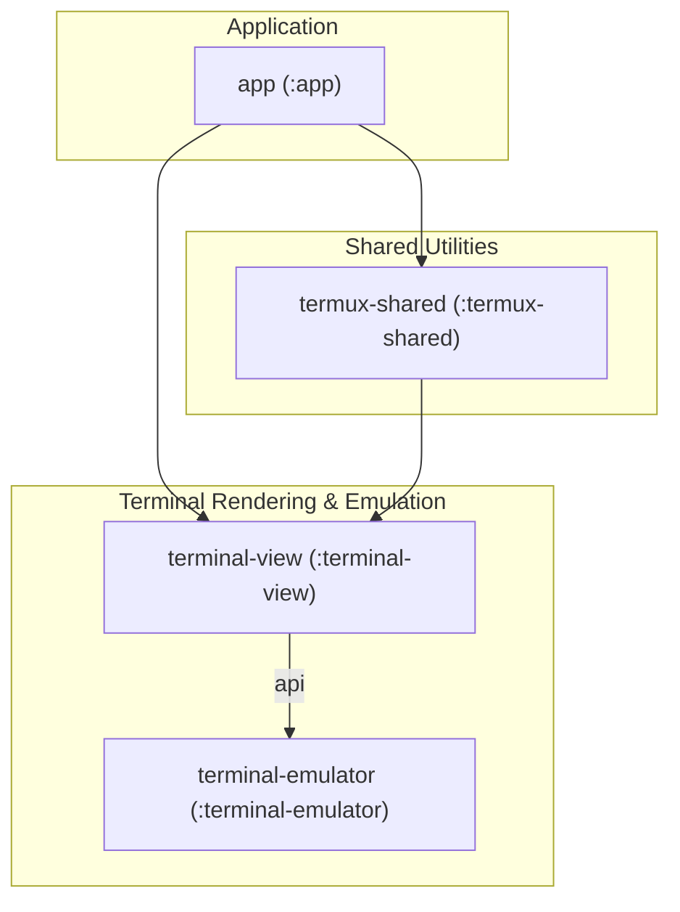

# Modules and Dependencies

Termux is structured as a multi-module Gradle project comprising an application module and three core library modules (`:app`, `:termux-shared`, `:terminal-emulator`, `:terminal-view`). This separation modularizes concerns across terminal emulation, rendering views, shared utilities/bootstrap logic, and the main application UI.

## Project Structure and Modules

As defined in `settings.gradle` (repo://settings.gradle#L1), the project includes four Gradle modules:

1. **`app`** (`com.termux`):
   - **Role**: The main Android application module (`com.android.application`).
   - **Responsibilities**: Provides the primary user interface (activities, fragments, drawer layout, preferences), terminal session management, settings storage, execution services, and bootstrapping.
   - **Dependencies**: Depends on `:terminal-view` and `:termux-shared`, as well as AndroidX libraries, Material Components, Guava, and Markwon Markdown parser.

2. **`termux-shared`** (`com.termux.shared`):
   - **Role**: Shared library module (`com.android.library`).
   - **Responsibilities**: Houses shared utilities, file operations, permissions, intent handling, bootstrap package configuration (`TermuxBootstrap.PackageVariant`), and execution helpers.
   - **Dependencies**: Depends on `:terminal-view`, AndroidX libraries, `hiddenapibypass`, `commons-io` (pinned to version `2.5` to avoid runtime exceptions on Android < 8 due to missing `java.nio.file.Path`), and `termux-am-library`.

3. **`terminal-view`** (`com.termux.view`):
   - **Role**: UI library module for rendering the terminal (`com.android.library`).
   - **Responsibilities**: Provides `TerminalView` and related view classes for handling touch input, scaling, scrolling, and rendering terminal screen contents.
   - **Dependencies**: Uses `api project(":terminal-emulator")` to expose the emulator API upstream, along with AndroidX annotations.

4. **`terminal-emulator`** (`com.termux.emulator`):
   - **Role**: Pure Java/C terminal emulation library (`com.android.library`).
   - **Responsibilities**: Implements ANSI/DEC VT terminal state machine emulation, screen buffer management, key input translation, and JNI-based terminal backend processing (`Android.mk`).
   - **Dependencies**: Pure library module with no upstream module dependencies; depends only on Android annotations and JUnit for unit testing.

## Inter-Module Dependency Graph

## Build Configuration & SDK Versions

Global project properties are centralized in `gradle.properties` (repo://gradle.properties#L18-L22) and applied across modules:

- **`minSdkVersion`**: `21` (Android 5.0 Lollipop)
- **`targetSdkVersion`**: `28` (Android 9.0 Pie)
- **`compileSdkVersion`**: `36`
- **`ndkVersion`**: `29.0.14206865` (with fallback to `JITPACK_NDK_VERSION`)

### Gradle Tooling & Plugins
- **Root Buildscript**: Uses Android Gradle Plugin `com.android.tools.build:gradle:8.13.2` with repositories configured for Google Maven and Central (repo://build.gradle#L1-L16).
- **Maven Publishing**: Library modules (`terminal-emulator`, `terminal-view`, `termux-shared`) apply the `maven-publish` plugin to produce release publications with sources and javadoc jars.
- **Java Compatibility**: Library modules configure Java 8 source and target compatibility (`JavaVersion.VERSION_1_8`), and `termux-shared` enables core library desugaring (`coreLibraryDesugaringEnabled true`) with `com.android.tools:desugar_jdk_libs:1.1.5`.
