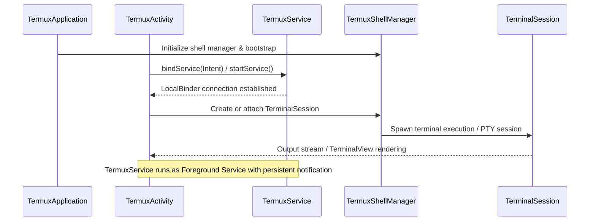

# System Architecture Overview

Termux-App is an Android terminal emulator and Linux environment application structured around a clean separation of concerns between application presentation (`TermuxActivity`), long-running background execution and session management (`TermuxService`), application bootstrapping and global initializations (`TermuxApplication`), and plugin/API integration components (such as broadcast receivers and remote action intents).

## Architectural Topology & Component Relationships

The application runs primarily within a single Android process, managed by `TermuxApplication`. The core runtime components and their interactions are illustrated below:

## Core Component Responsibilities

### 1. `TermuxApplication` (`com.termux.app.TermuxApplication`)
- **Role**: Application-wide entry point extending `android.app.Application`.
- **Responsibilities**:
  - Sets up global crash handling via `TermuxCrashUtils`.
  - Configures logging levels (`TermuxApplication.setLogConfig`).
  - Initializes package variant configurations (`TermuxBootstrap`), app-wide shared properties (`TermuxAppSharedProperties`), and the shell manager (`TermuxShellManager`).
  - Validates accessibility of the Termux files directory (`TermuxFileUtils.isTermuxFilesDirectoryAccessible`) and initializes the `TermuxAmSocketServer` for activity manager socket communication.
  - Generates and writes initial environment variables to file (`TermuxShellEnvironment`).

### 2. `TermuxService` (`com.termux.app.TermuxService`)
- **Role**: Foreground service responsible for maintaining terminal sessions and background execution tasks (`AppShell`) across activity lifecycles.
- **Responsibilities**:
  - Runs as a foreground service (`startForeground`) displaying a persistent status notification to prevent Android from killing active shell sessions.
  - Manages active `TermuxSession` instances and background tasks through `TermuxShellManager`.
  - Provides binder interface (`LocalBinder`) for local communication with `TermuxActivity`.
  - Handles wake locks (`ACTION_WAKE_LOCK`) and wifi locks to ensure long-running execution continuity.
  - Listens to system package update events via `SystemEventReceiver`.

### 3. `TermuxActivity` (`com.termux.app.TermuxActivity`)
- **Role**: The primary user-facing terminal emulator activity (`AppCompatActivity`).
- **Responsibilities**:
  - Binds to `TermuxService` via `ServiceConnection`.
  - Manages the UI hierarchy (`TermuxActivityRootView`), `TerminalView`, terminal session lists (`TermuxSessionsListViewController`), toolbar viewpagers, and extra keys views (`ExtraKeysView`).
  - Implements terminal view clients (`TermuxTerminalViewClient`) and activity session clients (`TermuxTerminalSessionActivityClient`) to handle user input, touch events, visual styling changes, and clipboard interactions.
  - Handles Activity lifecycle transitions (`onResume`, `onStop`, `onDestroy`) ensuring clean disconnection of activity-bound terminal session clients when UI goes out of visibility.

### 4. Broadcast Receivers & Integration Components
- **`SystemEventReceiver`**: Manages system broadcast registrations (e.g., package updates).
- **`FileReceiverActivity`**: Handles external file sharing intents into Termux environments.
- **`TermuxAmSocketServer`**: Local socket server supporting Android activity manager integration for sub-processes.

## Lifecycle & Invariants

- **Service Longevity**: `TermuxService` outlives `TermuxActivity`. When the user closes or rotates the activity, unbinding disconnects UI callbacks without terminating active shell sessions or background tasks.
- **Foreground Persistence**: While sessions or background tasks are active, `TermuxService` maintains a foreground notification, ensuring OS resource allocators prioritize the terminal environment.
- **Process Model**: All core components run within the main application process, communicating via local binder IPC and direct state managers (`TermuxShellManager`).
