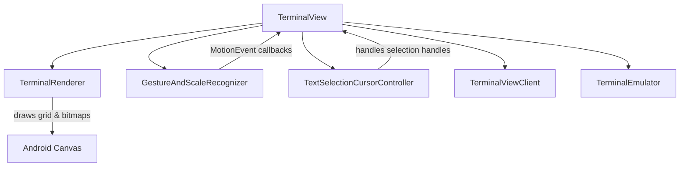

# Terminal View & Rendering

The `terminal-view` library provides the graphical Android UI component (`TerminalView`), rendering engine (`TerminalRenderer`), touch gesture recognition (`GestureAndScaleRecognizer`), and text selection controllers (`TextSelectionCursorController`, `TextSelectionHandleView`) that display and interact with a underlying `TerminalSession` and `TerminalEmulator` from `terminal-emulator`.

## Architectural Overview & Responsibilities

`TerminalView` extends Android's `View` class and acts as the central coordinator between user interactions (touch, mouse, keyboard, IME, accessibility) and the terminal emulation core.

*Architecture and component relationships in terminal-view.*

- **`TerminalView`**: The core Android `View` managing lifecycle, input connection (`InputConnection` for IMEs/keyboards), key events, mouse tracking, scroll gestures, scaling (pinch-to-zoom), autofill, accessibility, and session attachment.
- **`TerminalRenderer`**: Responsible for rendering a `TerminalEmulator` state (including transcript buffer, active grid, sixel graphics bitmaps, text styles, colors, and cursors) onto an Android `Canvas`.
- **`GestureAndScaleRecognizer`**: Combines Android's `GestureDetector` and `ScaleGestureDetector` to interpret single taps, double taps, scrolls, flings, long presses, and pinch scaling.
- **`TextSelectionCursorController`**: Manages text selection mode, touch interaction with selection handles (`TextSelectionHandleView`), clipboard copy/paste, and selection coordinates.
- **`TerminalViewClient`**: An interface allowing communication and callbacks between `TerminalView` and its container activity or application layer (e.g., Termux app).

---

## Rendering Pipeline (`TerminalRenderer`)

`TerminalRenderer` caches font metrics (`Typeface`, text size, line spacing, ascent, and character width for monospace rendering) and draws terminal rows.

### Key Rendering Steps
1. **Reverse Video / Background Clearing**: If reverse video is active, the canvas background is initialized to the foreground color.
2. **Row Iteration**: Iterates over visible screen rows from `topRow` up to `topRow + mEmulator.mRows`.
3. **Line Allocation & Sixel Support**: Fetches `TerminalRow` objects from the screen buffer. If a style entry designates a Sixel graphics bitmap (`TextStyle.isTerminalBitmap(style)`), it draws the bitmap region onto the canvas grid coordinates.
4. **Run-Length Style Grouping**: Adjacent characters sharing identical text attributes (foreground/background colors, bold, underline, italic, strike-through, dim, cursor occupancy, and selection state) are grouped into runs (`drawTextRun`) to minimize `Canvas.drawText` calls.
5. **Width Mismatch Handling**: Compares measured font widths against expected Unicode character column widths (`WcWidth.width(codePoint)`). If a font width mismatch occurs (e.g., wide emoji or non-monospaced fonts), it scales the text run to match expected column widths.
6. **Cursor Rendering**: Highlights cells occupied by the terminal cursor according to the active cursor style (block, underline, or bar) and inverts text colors for block cursors.

---

## Touch Gestures & Input Handling

Touch events are intercepted in `TerminalView#onTouchEvent(MotionEvent)` and forwarded to `GestureAndScaleRecognizer`.

### Gesture Recognition (`GestureAndScaleRecognizer`)
- **Single Tap Up**: Focuses the view, dismisses text selection if active, and triggers `TerminalViewClient#onSingleTapUp`.
- **Scroll**: Computes vertical delta rows based on font line spacing and invokes `doScroll`, updating `mTopRow` or sending mouse scroll events if mouse tracking is active.
- **Fling**: Uses Android's `Scroller` to create smooth inertial scrolling animations across transcript rows.
- **Scale (Pinch-to-Zoom)**: Adjusts the font scale factor via `TerminalViewClient#onScale`.
- **Long Press**: Triggers haptic feedback and initiates text selection mode (`startTextSelectionMode`).

### Mouse Tracking & Reporting
When terminal applications activate mouse tracking (e.g., `xterm` mouse reporting in `vim` or `tmux`), touch events outside text selection are translated into terminal mouse escape sequences (`sendMouseEventCode`) for buttons and motion events.

---

## Keyboard, IME, & Hardware Keys

`TerminalView` implements full keyboard handling:
- **`onCreateInputConnection`**: Returns a custom `InputConnection` supporting software keyboards, IMEs, composing text, committing text, and character deletion (handling combining accents and surrogate pairs).
- **`onKeyDown` / `onKeyUp`**: Maps hardware keyboard `KeyEvent` objects through `KeyHandler` and `TerminalEmulator` to generate correct escape sequences or character inputs.
- **Key Logging**: Optional debug logging controlled by `setIsTerminalViewKeyLoggingEnabled`.

---

## Text Selection & Clipboard Operations

When a user long-presses the terminal view:
1. `startTextSelectionMode(MotionEvent)` initializes `TextSelectionCursorController`.
2. `TextSelectionCursorController` displays start and end selection handles (`TextSelectionHandleView`).
3. Users can drag handles to select text across the active screen and scrollback transcript.
4. Selected text can be copied to Android's `ClipboardManager` via actions exposed to the client.

---

## Invariants & Failure Semantics

- **Session Attachment**: `attachSession` safely updates `mTermSession` and resets transcript scrolling (`mTopRow = 0`), handling null emulators gracefully.
- **Font Metrics Cache**: `TerminalRenderer` caches font metrics; any change in font size or typeface requires instantiating a new `TerminalRenderer` instance to prevent layout corruption or incorrect line spacing.
- **Scroll Bounds**: `mTopRow` is strictly bounded between `-activeTranscriptRows` and `0`.
