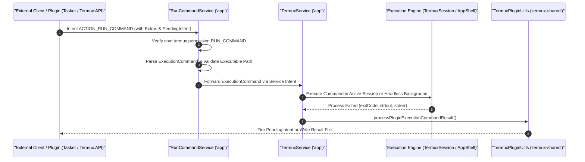

# Plugin Protocol & Intent Dispatching

Termux exposes a standardized Inter-Process Communication (IPC) protocol enabling external applications—such as automation frameworks (Tasker, Automate) and official Termux plugins (`Termux:API`, `Termux:Widget`, `Termux:Tasker`)—to trigger command execution and retrieve execution results.

## Protocol Architecture & Lifecycle

## Intent Contract (`com.termux.RUN_COMMAND`)

External callers initiate execution by sending an explicit or implicit service intent directed to `com.termux.app.RunCommandService` with action `com.termux.RUN_COMMAND`.

### Intent Extras Specification
- **`com.termux.RUN_COMMAND_PATH`** *(String, Required)*: Absolute path to the executable or script (e.g., `/data/data/com.termux/files/usr/bin/python`).
- **`com.termux.RUN_COMMAND_ARGUMENTS`** *(StringArray, Optional)*: Array of arguments passed to the executable.
- **`com.termux.RUN_COMMAND_WORKDIR`** *(String, Optional)*: Working directory for the process (defaults to `$HOME`).
- **`com.termux.RUN_COMMAND_BACKGROUND`** *(Boolean, Optional)*: If `true`, the process runs headlessly without creating a GUI terminal session (`AppShell`); if `false`, opens or attaches to a terminal session (`TermuxSession`).
- **`com.termux.RUN_COMMAND_SESSION_ACTION`** *(String, Optional)*: Defines session behavior if running in foreground (e.g. keep session open or auto-close upon process exit).
- **`com.termux.RUN_COMMAND_PENDING_INTENT`** *(PendingIntent, Optional)*: Callback intent triggered upon execution completion containing exit code, stdout, and stderr.
- **`com.termux.RUN_COMMAND_RESULT_DIRECTORY`** *(String, Optional)*: Directory where stdout and stderr log files will be persisted.

## Result Delivery (`TermuxPluginUtils.java`)

When the command completes, `TermuxPluginUtils.processPluginExecutionCommandResult()` routes execution telemetry:
1. **PendingIntent Callback**:
   - Extras bundled into the result intent include:
     - `stdout`: Captured standard output.
     - `stderr`: Captured standard error.
     - `exitCode`: Process exit status integer.
     - `errCode`: Internal Termux error code (if dispatch failed).
     - `errmsg`: Human-readable error message.
2. **Directory Storage**:
   - If `RUN_COMMAND_RESULT_DIRECTORY` is specified, files `stdout.txt`, `stderr.txt`, and `result.txt` are created atomically.

## Related Documents
- [Permissions & Security Architecture](permissions-and-security.md)
- [Command Execution Workflow](../workflows/command-execution.md)
- [TermuxService Background Architecture](../architecture/service-and-background-runtime.md)
