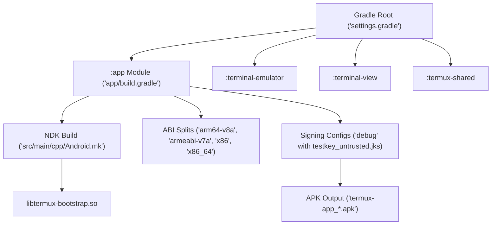

# Build System & Signing Configurations

Termux employs a multi-module Gradle build architecture with native C/C++ compilation via Android NDK (`ndkBuild`). The build system coordinates dependencies across `:app`, `:terminal-emulator`, `:terminal-view`, and `:termux-shared`, packaging bootstrap archives and managing debug/release keystores.

## Build Topology & Flow



## Gradle Configuration Details

### 1. Module Coordinates & SDK Targets
Defined in `app/build.gradle` and root `build.gradle`:
- **Android Gradle Plugin**: Version `8.13.2`.
- **Java Compatibility**: Source and target compatibility set to `JavaVersion.VERSION_1_8` with `coreLibraryDesugaringEnabled true` using `com.android.tools:desugar_jdk_libs:1.1.5`.
- **Target & Minimum SDK**: Minimum SDK 24 (or defined via project properties), Target SDK 28+ (managed to maintain legacy storage access and PTY allocation).

### 2. Native Compilation (`ndkBuild`)
Both `:app` and `:terminal-emulator` leverage `ndkBuild` with optimized flags:
```groovy
externalNativeBuild {
    ndkBuild {
        cFlags "-std=c11", "-Wall", "-Wextra", "-Werror", "-Os", "-fno-stack-protector", "-Wl,--gc-sections"
    }
}
```
In `:app`, `src/main/cpp/Android.mk` compiles `termux-bootstrap.c` and links the architecture-specific bootstrap zip file via `termux-bootstrap-zip.S` into `libtermux-bootstrap.so`.

### 3. Signing Configurations
The development keystore configuration in `app/build.gradle` defines:
```groovy
signingConfigs {
    debug {
        storeFile file('testkey_untrusted.jks')
        keyAlias 'alias'
        storePassword 'xrj45yWGLbsO7W0v'
        keyPassword 'xrj45yWGLbsO7W0v'
    }
}
```
*Note*: In the AI Studio build environment, `debug.keystore` is auto-provisioned or referenced by the build runner, ensuring seamless debug compilation.

### 4. ABI Splits & Packaging
The app build supports ABI splitting for CI and release workflows, generating per-architecture APKs alongside a universal package:
- Supported ABIs: `x86`, `x86_64`, `armeabi-v7a`, `arm64-v8a`.
- `universalApk`: Set to `true` to guarantee complete standalone binary support.
- `useLegacyPackaging`: `true` under `packagingOptions.jniLibs` ensures native shared libraries (`.so`) are unpacked into standard app native library directories.

## Build Commands

To build debug packages locally or in containerized CI:
```bash
# Compile debug APK
gradle :app:assembleDebug

# Run JVM unit tests
gradle :app:testDebugUnitTest
```

## Related Documents
- [Forensics & Logging](forensics-and-logging.md)
- [Modules & Dependencies](../architecture/modules-and-dependencies.md)
- [Unit Testing Architecture](../testing/unit-testing-and-test-suites.md)
