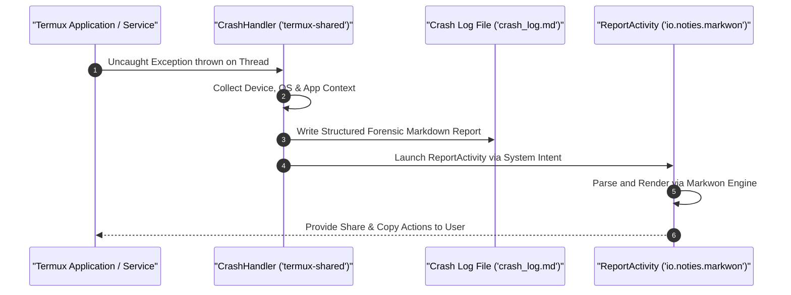

# Forensics & Logging Subsystem

Termux integrates a comprehensive diagnostic and telemetry capture pipeline designed to intercept runtime errors, generate structured forensic crash reports, and display them in a clean Markdown viewer without requiring an external debugger.

## Forensic Interception Flow

## Core Components

### 1. Uncaught Exception Interception (`CrashHandler.java`)
`CrashHandler` implements `Thread.UncaughtExceptionHandler`. Initialized during `TermuxApplication.onCreate()`, it traps unexpected runtime failures:
- Captures active thread state, stack traces, and cause chains.
- Collects environment details: Android OS build version, kernel release, architecture (`Build.SUPPORTED_ABIS`), Termux app version, and package variant.
- Serializes telemetry into a structured Markdown document saved under the app's internal cache or storage directory.

### 2. Runtime Telemetry Viewer (`ReportActivity.java`)
When a crash occurs or when the user invokes diagnostics, `ReportActivity` is launched:
- Uses the **Markwon** markdown rendering library (`io.noties.markwon:core`, `io.noties.markwon:ext-strikethrough`, `io.noties.markwon:linkify`, `io.noties.markwon:recycler`).
- Displays formatted stack traces in monospace blocks with syntax styling.
- Features top app bar action items allowing the user to copy the raw markdown to the clipboard or share it via Android's `Intent.ACTION_SEND`.

### 3. Unified Logger (`Logger.java`)
`com.termux.shared.logger.Logger` provides granular logging across all modules:
- Supports standard log levels: `VERBOSE`, `DEBUG`, `INFO`, `WARN`, `ERROR`.
- Features extended logging methods (e.g. `logVerboseExtended`) for multiline intent dumps and shell outputs.
- Integrates with user settings (`TermuxAppSharedPreferences`) allowing dynamic log level toggling without app recompilation.

## Related Documents
- [Crash Handling & Diagnostics Architecture](../architecture/crash-handling-and-diagnostics.md)
- [Build System & Signing Configurations](build-and-signing.md)
- [Settings & Preferences](../concepts/settings-and-preferences.md)
