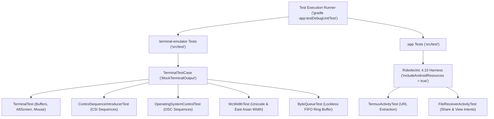

# Unit Testing & Test Suites

Termux employs local JVM unit testing across all modules to validate terminal emulation semantics, screen buffer manipulations, character widths, and Android activity intent filtering without requiring physical Android hardware or an active emulator.

## Test Harness Architecture



## Terminal Emulation Test Harness (`TerminalTestCase.java`)

In `:terminal-emulator/src/test/`, `TerminalTestCase` extends `junit.framework.TestCase` to create a lightweight, in-memory terminal emulation sandbox.

### Mock Output Interceptor (`MockTerminalOutput`)
```java
public static class MockTerminalOutput extends TerminalOutput {
    final ByteArrayOutputStream baos = new ByteArrayOutputStream();
    public final List<ChangedTitle> titleChanges = new ArrayList<>();
    public final List<String> clipboardPuts = new ArrayList<>();
    public int bellsRung = 0;
    public int colorsChanged = 0;

    @Override
    public void write(byte[] data, int offset, int count) {
        baos.write(data, offset, count);
    }
}
```
- Traps terminal response bytes (e.g. Device Attributes `DA`, Primary Device Attributes, Cursor Position Reports) without native PTY pipes.
- Counts bell triggers (`bellsRung`), title updates (`titleChanges`), and clipboard operations (`onCopyTextToClipboard`).

### Key Parser Test Suites
1. **`TerminalTest.java`**:
   - Validates main screen buffer vs. alternate screen buffer (`\033[?1049h`).
   - Ensures cursor positioning and text transcript extraction match expected grid geometries.
   - Verifies mouse tracking modes (`\033[?1000h` / `\033[?1000l`).
2. **`ControlSequenceIntroducerTest.java`**:
   - Asserts cursor motion (CUU, CUD, CUF, CUB), erasing in display (ED), and erasing in line (EL).
3. **`OperatingSystemControlTest.java`**:
   - Validates OSC 0 / OSC 2 window title setting, OSC 4 color palette modifications, and OSC 52 clipboard copying.
4. **`WcWidthTest.java`**:
   - Validates Unicode standard character width classifications (`WcWidth.width(int ucs)`), checking zero-width combining marks, wide emoji characters, and East Asian wide characters.
5. **`ByteQueueTest.java`**:
   - Validates circular FIFO queue operations across concurrent reading and writing threads.

## Android Layer Tests with Robolectric (`:app`)

The `:app` module uses Robolectric (`org.robolectric:robolectric:4.10`) for testing Android components on local JVMs:
- Configured with `testOptions.unitTests.includeAndroidResources = true` in `app/build.gradle`.
- **`TermuxActivityTest.java`**: Tests URL pattern matching and extraction from terminal terminal rows using `TermuxUrlUtils.extractUrls()`.
- **`FileReceiverActivityTest.java`**: Tests handling of incoming file share intents (`android.intent.action.SEND` / `android.intent.action.VIEW`), verifying temporary storage and staging paths.

## Execution Constraints & Quality Gate

In containerized CI and cloud development environments:
- **No Instrumented Tests**: Instrumented tests requiring an emulator (`androidTest/`) are unsupported due to the lack of ADB and hypervisor access.
- **Execution Command**:
  ```bash
  # Execute all JVM tests in the app module
  gradle :app:testDebugUnitTest

  # Execute all emulator parser tests
  gradle :terminal-emulator:test
  ```

## Related Documents
- [Build System & Signing Configurations](../operations/build-and-signing.md)
- [Terminal Emulation Engine](../concepts/terminal-emulation.md)
- [Session Lifecycle](../workflows/session-lifecycle.md)
