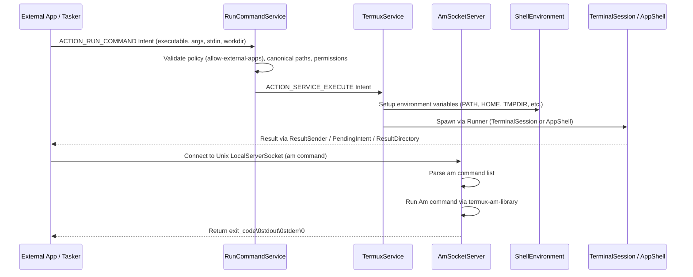

# Command Execution Workflow

The command execution workflow in Termux spans external intent handling via `RunCommandService`, foreground execution coordination via `TermuxService`, local socket integration via `AmSocketServer`, and dynamic environment variable setup via Termux shell environment providers.

*Sequence of external command execution through RunCommandService and AmSocketServer.*

## RunCommandService Intent Handling

`RunCommandService` acts as the primary service entry point for third-party apps, plugins (such as Tasker plugins), and automated scripts to run commands inside the Termux app context.

### Lifecycle and Security Checks
1. **Foreground Service Requirement:** When started, `RunCommandService` immediately promotes itself to a foreground service with a silent notification (`runStartForeground()`) to prevent Android OS from killing the service prematurely.
2. **Intent Action Validation:** The incoming intent action must equal `RUN_COMMAND_SERVICE.ACTION_RUN_COMMAND`. If invalid, the service logs the error, invokes `TermuxPluginUtils.processPluginExecutionCommandError()`, and stops.
3. **External Apps Policy (`allow-external-apps`):** It checks whether external app execution is permitted (`TermuxPluginUtils.checkIfAllowExternalAppsPolicyIsViolated()`). If violation occurs, execution is aborted, and security notifications are dispatched to alert the user against potentially malicious third-party integrations.
4. **Result Configuration:** Supports asynchronous result reporting via `PendingIntent`, single files, or directory result outputs (`EXTRA_RESULT_DIRECTORY`, `EXTRA_RESULT_SINGLE_FILE`, `EXTRA_RESULT_FILE_BASENAME`).

### Argument Sanitization and Path Resolution
- **Comma Alternative Replacement:** When commands are dispatched via Android's `am` command-line tool, commas within arguments may be escaped or altered. If `EXTRA_REPLACE_COMMA_ALTERNATIVE_CHARS_IN_ARGUMENTS` is set, `RunCommandService` restores normal comma characters (`TermuxConstants.COMMA_NORMAL`) using `DataUtils.replaceSubStringsInStringArrayItems()`.
- **Canonical Paths & Permissions:** The executable path (`EXTRA_COMMAND_PATH`) and working directory (`EXTRA_WORKDIR`) are resolved into canonical absolute paths via `TermuxFileUtils.getCanonicalPath()`. Regular file existence, read/execute permissions (`FileUtils.APP_EXECUTABLE_FILE_PERMISSIONS`), and directory write permissions are rigorously validated before forwarding.
- **Symlink Expansion:** If the executable points to a symlink (such as a BusyBox or coreutils applet), the original symlink path is retained so that applets receive correct argv[0] semantics instead of raw canonical paths.

Once validated, `RunCommandService` wraps the parameters into an `ExecutionCommand` and fires an `ACTION_SERVICE_EXECUTE` intent to `TermuxService`.

## TermuxService Execution Dispatch

`TermuxService` coordinates local terminal sessions (`TerminalSession`) and background process tasks (`AppShell`).

- **Runners:** Commands specify a runner (`ExecutionCommand.Runner`), typically `TERMINAL_SESSION` (interactive terminal session visible in the UI) or `APP_SHELL` (background execution task).
- **Session Management:** `TermuxShellManager` tracks active sessions and tasks. Wake locks and Wi-Fi locks can be acquired dynamically to ensure long-running background tasks do not get suspended by the OS power manager.

## AmSocketServer Integration

`AmSocketServer` provides an AF_UNIX / SOCK_STREAM local server managed via `LocalSocketManager`. It allows clients (such as native C binaries or local helper utilities) to execute Android Activity Manager (`am`) commands without spawning heavy Java VM processes for each invocation.

- **Connection & Security:** Limits connections to processes belonging to the server app's user ID and root user (`getPeerCred()`). Filesystem domain sockets are preferred over abstract namespace sockets for filesystem permission security.
- **Protocol:** Clients write the `am` command string (omitting the leading `"am"` program name) on the socket output stream and read back the response.
- **Response Format:** Results are serialized as `exit_code\0stdout\0stderr\0`, where `\0` represents a null byte separator.
- **Execution Engine:** Incoming command strings are tokenized via `ArgumentTokenizer` and executed via the embedded `com.termux.am.Am` library.

## Shell Environment Variable Setup

Before spawning any shell or command runner, Termux constructs a robust POSIX and Android-compatible environment via `TermuxShellEnvironment` and supporting environment providers:

- **Core Variables:** Sets up essential environment paths including `PATH` (pointing to Termux binary directories like `$PREFIX/bin`), `HOME` (`$HOME`), `TMPDIR` (`$TMPDIR`), `PREFIX`, and `LD_LIBRARY_PATH`.
- **Plugin Environments:** Integrates plugin-specific environment variables (`TermuxAPIShellEnvironment`, `TermuxAppShellEnvironment`) to ensure scripts executed via plugins have access to Termux API binaries and shared assets.
- **Customization:** Environment definitions are dynamically evaluated and merged into process builder configurations for both `TerminalSession` and `AppShell`.
---
---
