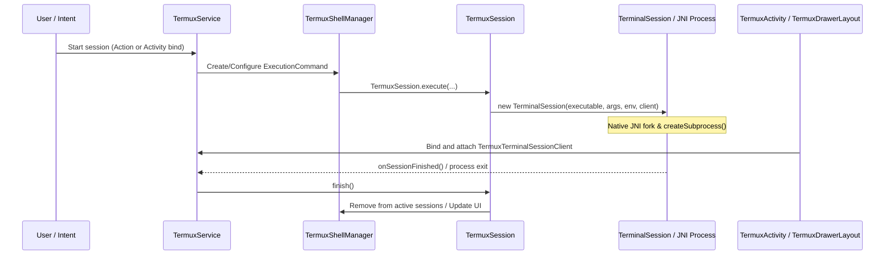

# Terminal Session Lifecycle

Terminal sessions in Termux represent interactive or automated shell processes coupled to a pseudo-terminal (pty) interface. The lifecycle encompasses bootstrap verification, environment preparation, process spawning via native Unix system calls, foreground service management via `TermuxService`, UI binding and drawer interaction via `TermuxDrawerLayout` and `TermuxSessionsListViewController`, and final cleanup/destruction.

## Core Components and Responsibilities

- **`TermuxInstaller`**: Verifies bootstrap package installation and ensures that `$PREFIX` and file directories are accessible for shell execution.
- **`TermuxService`**: A foreground Android `Service` that maintains active `TermuxSession` instances via `TermuxShellManager`, keeps the system awake when needed, and manages foreground notification state.
- **`TermuxSession`**: Bridges an `ExecutionCommand` (containing command arguments, working directory, and environment variables) with an underlying `TerminalSession`.
- **`TerminalSession`**: Manages the native subprocess via JNI (`JNI.createSubprocess`), I/O thread queues (`ByteQueue`), and terminal emulation (`TerminalEmulator`).
- **`TermuxActivity` & `TermuxDrawerLayout`**: Binds active terminal sessions to the UI, manages session switching via the navigation drawer, and prevents touch event propagation errors (`ViewDragHelper` orphan motion handling).
- **`TermuxSessionsListViewController`**: Manages the adapter view listing active sessions in the slide-out drawer.

## Lifecycle Flow

## Detailed Initialization & Execution Flow

1. **Bootstrap & Environment Setup**:
   Before spawning any shell, `TermuxInstaller` ensures bootstrap utilities exist under `$PREFIX`. When a session request is initiated, `TermuxSession.execute()` constructs the command environment (`IShellEnvironment`), loads appropriate shell binaries (login shells or fallback `/system/bin/sh`), and prepares environment variables and argument arrays.

2. **Process Spawning (`TerminalSession`)**:
   `TerminalSession` instantiates communication queues (`mProcessToTerminalIOQueue` and `mTerminalToProcessIOQueue`) and invokes the native JNI method `JNI.createSubprocess(...)` to fork the Unix process, create a pseudo-terminal master/slave pair, and assign the process group.

3. **Service Management & UI Binding (`TermuxService` & `TermuxDrawerLayout`)**:
   Active sessions are stored in `TermuxShellManager.mTermuxSessions`. `TermuxService` runs as a foreground service (`startForeground`) to ensure that background shell processes are not terminated by Android's low-memory killer. `TermuxActivity` binds to `TermuxService` on startup, attaching session clients and configuring `TermuxDrawerLayout` to handle touch dispatching safely without spurious `ViewDragHelper` pointer errors.

4. **Termination & Cleanup**:
   When the child process exits (or receives a signal like `SIGKILL` via `killIfExecuting`), `TerminalSession` detects the exit status. `TermuxService` receives `onSessionFinished()`, calls `TermuxSession.finish()`, updates execution state, triggers notification updates, and removes the session from active lists.
